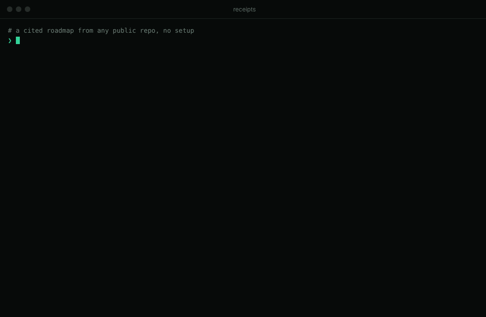
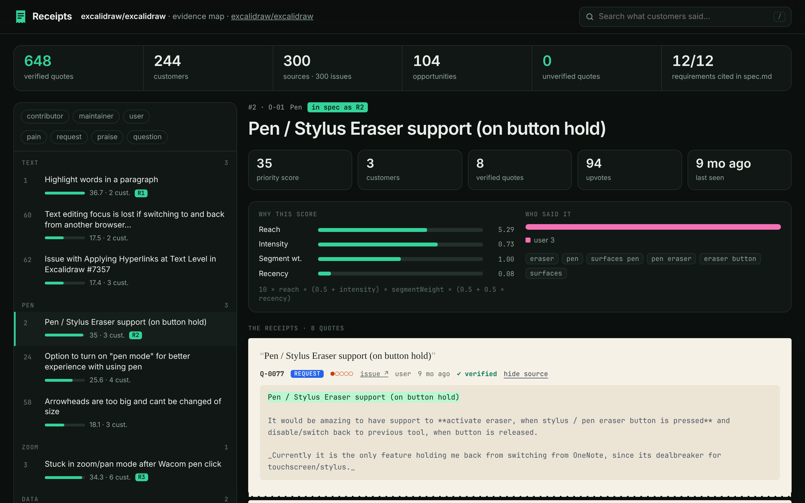

<div align="center">


# Receipts

**No requirement without a receipt.**

Turn customer feedback into specs where every requirement cites verified customer quotes, then check those specs in CI before your AI agent builds them.

[](https://github.com/akhsterminator/receipts/actions/workflows/ci.yml)
[](https://www.npmjs.com/package/@hashimua/receipts)
[](LICENSE)
[](product/spec.md)

[Quick start](#quick-start) · [How it works](#how-it-works) · [Verification](#how-quotes-are-verified) · [Privacy](#privacy) · [Integrations](#integrations) · [Roadmap](#roadmap) · [**The product behind it →**](product/)



</div>

---

AI coding agents now build straight from specs, through GitHub's Spec Kit, Claude Code, Cursor and the like. That makes the spec the most important thing a product manager writes, and **nothing checks that a requirement actually came from customers.**

Receipts reads your interview transcripts, support tickets, app reviews and GitHub issues. It pulls out what customers said and **verifies every quote word for word against its source**. Then it ranks the opportunities with a formula you can read and edit, and writes a spec where each requirement cites its evidence. A `check` command lints any spec, locally or in CI, before an agent builds anything.

## Quick start

Try it on any public GitHub repo. No account, no API key, no config:

```bash
npx @hashimua/receipts github excalidraw/excalidraw
```

That reads the 300 most-upvoted open issues and writes a ranked, cited roadmap, `spec.md` and an interactive evidence map into `receipts-excalidraw/`. For excalidraw it found 648 verified quotes and 104 opportunities; the analysis takes under a second once the issues are fetched. **[See the result →](https://akhsterminator.github.io/receipts/excalidraw/)**

On your own feedback:

```bash
npx @hashimua/receipts init                 # config + a feedback/ folder
npx @hashimua/receipts run feedback/        # ingest → verify → rank → spec.md + evidence map
npx @hashimua/receipts check spec.md        # lint the spec you edited
```

Or see the whole loop on sample data from Tempo, a fictional fitness-class subscription app: `npx @hashimua/receipts demo`.

## A cited spec

Each requirement says why it exists and how you'll know it worked:

```md
## R3. Let users pause a subscription for up to 3 months
because: [Q-0142, Q-0388, Q-0911]   # 23 customers · 4 segments · last seen 6 days ago
metric: Monthly-plan churn −10% within 90 days

> "I would honestly rather pause than cancel but I couldn't find a pause button anywhere in the app." — Q-0142
```

To build something without evidence, own it:

```md
## R8. Public API for gym partners
bet: Two gym chains asked in sales calls. We'll run 5 partner interviews before building more than a prototype.
```

Then check it:

```console
$ receipts check spec.md
✗ R4 misquotes Q-0091. The customer said: "Downloading a few classes the night before would be ideal."  spec.md:32
✗ R7 has no evidence. Add because: or mark it bet:                                                     spec.md:44
⚠ R5 rests on 1 customer (loudest-voice risk)                                                          spec.md:34
⚠ Q-0064 is 15 months old (cited by R6)                                                                spec.md:41
✗ 6/8 requirements cited · 125 verified quotes · 0 unverified · 1 bet
```

The `bet:` marker is the point. Product work needs deliberate bets. Receipts makes them visible and owned instead of hiding them among evidence-backed requirements. Full grammar and rules: **[docs/spec-format.md](docs/spec-format.md)**.

## How it works

```
 transcripts · tickets · reviews · GitHub issues
                    │
          1  ingest     CSV / JSON / .txt .md .vtt .srt .docx / GitHub API
          2  redact     personal data removed on your machine, customers pseudonymised
          3  extract    Claude, Ollama or offline heuristics propose quotes
          4  verify     every quote must appear word for word in its source, or it's dropped
          5  cluster    quotes → opportunities → themes (jobs-to-be-done framing with Claude)
          6  score      reach × intensity × segment weight × recency, editable in config
          7  write      spec.md with because: citations, plus a self-contained evidence map
          8  check      locally, in CI, or by your coding agent over MCP
                    │
     Spec Kit · Linear · GitHub issues · Claude Code
```



<sub>The evidence map (`receipts view`): every opportunity with its score broken down, who said it, and each quote shown in the context of its source. One HTML file, no server.</sub>

### Prioritisation you can argue with

Every score shows its parts. The default formula lives in your `receipts.config.ts`, so a team can change it in a pull request rather than a meeting:

```ts
score: ({ breakdown: b }) =>
  10 * b.reach * (0.5 + b.intensity) * b.segmentWeight * (0.5 + 0.5 * b.recency),
```

| Factor | Meaning |
| --- | --- |
| reach | `log2(1 + distinct customers)`, plus upvotes for GitHub issues. Ten quotes from one customer count as one voice |
| intensity | How strongly they feel: pain language, threats to churn, "deal-breaker". Each customer's strongest quote, averaged |
| segment weight | Your weights, e.g. enterprise 1.5, free 0.6 |
| recency | Exponential decay, half-life 120 days by default |

## How quotes are verified

Models are good at sounding like your customers, so Receipts never takes a model's word for a quote:

1. The extractor (Claude, Ollama or the offline heuristic) only **proposes** quotes.
2. Each proposal must appear **verbatim** in the redacted source. Only whitespace, curly-vs-straight quotes, dash and ellipsis characters may differ. Paraphrases, changed capitalisation, "…" elisions and fixed typos are rejected.
3. Quotes from the interviewer, or quotes spanning two speakers, are rejected.
4. What's stored is the **exact substring** from the source, with character offsets and a SHA-256 hash. The model's version is thrown away.
5. Every `receipts check` re-verifies cited quotes, so hand-editing the store or a source is caught.

When a model paraphrases, you'll see `dropped 3 quotes that did not appear word for word in the source`. That's the system working. Details and limits: **[docs/verification.md](docs/verification.md)**.

## Privacy

Receipts is local-first:

- **Personal data is removed before anything is written or sent anywhere:** emails, phones, card numbers, IBANs, IDs, IPs, addresses, social handles, API keys, names in greetings, sign-offs and introductions, names from CSV columns, and transcript speaker names.
- **Customers become salted hashes** (`cust_3f9a1c0e`). The salt stays on your machine (gitignored), so a committed store can't be reversed by hashing known emails.
- **It runs fully offline** with the heuristic extractor or [Ollama](docs/integrations.md#ollama-fully-local). With Claude, only redacted text is sent, under your own API key.
- **No telemetry.** Receipts never phones home.

Redaction is pattern-based and deliberately aggressive, but it isn't a compliance guarantee. See [SECURITY.md](SECURITY.md).

## Integrations

| | |
| --- | --- |
| **Claude Code / MCP** | `claude mcp add receipts -- npx -y @hashimua/receipts mcp`. Your agent can call `why R3`, `search_evidence` and `check_spec` while it builds, so it resolves ambiguity the way customers asked |
| **GitHub Actions** | `uses: akhsterminator/receipts@v0`. Findings appear as annotations on the spec in the PR diff, plus a job summary |
| **GitHub Spec Kit** | `receipts export speckit` writes `specs/001-…/spec.md` with evidence carried into user stories, FRs and success criteria |
| **Linear** | `receipts export linear` → CSV import with quotes in each issue |
| **GitHub issues** | `receipts export github` → one Markdown file per requirement + a `gh` script |
| **Claude API** | Set `ANTHROPIC_API_KEY` for model extraction, jobs-to-be-done clustering and drafted requirement titles and metrics (`claude-opus-5-5` by default) |
| **Ollama** | `--extractor ollama` for local models |

Setup for each: **[docs/integrations.md](docs/integrations.md)**. All options: **[docs/configuration.md](docs/configuration.md)**.

<details>
<summary><b>All commands</b></summary>

| Command | What it does |
| --- | --- |
| `receipts demo` | Whole pipeline on bundled sample data |
| `receipts github <owner/repo>` | Cited roadmap from a repo's most-upvoted issues |
| `receipts init [--ci]` | Config, `feedback/` folder, optional GitHub workflow |
| `receipts run <paths…>` | Ingest → extract → cluster → spec → evidence map |
| `receipts ingest <paths…>` | Add feedback (PII removed first) |
| `receipts extract` | Mine verified quotes (`--extractor claude\|ollama\|heuristic`) |
| `receipts synthesize` | Cluster and score opportunities |
| `receipts spec` | Write a cited spec from the top opportunities |
| `receipts check [spec]` | Lint a spec (`--format pretty\|json\|github\|markdown`, `--strict`) |
| `receipts why <R-id>` | The evidence behind a requirement |
| `receipts quote <Q-id>` | One quote in the context of its source |
| `receipts search <query>` | Search everything customers said |
| `receipts opportunities` | Ranked opportunities |
| `receipts sources` | What was ingested and how much was redacted |
| `receipts verify` | Re-verify every quote in the store |
| `receipts view [--open]` | Write the evidence map |
| `receipts export <format>` | `speckit`, `linear`, `github`, `json` |
| `receipts mcp` | MCP server (stdio) |

</details>

<details>
<summary><b>FAQ</b></summary>

**Do I need an API key?** No. Without one, Receipts uses a deterministic offline extractor. It's fast and private, but cruder: it can't tell "freeze my membership" from "the app freezes". With `ANTHROPIC_API_KEY` set, extraction, clustering and requirement drafting use Claude.

**What does it cost with Claude?** Small sources are batched into requests of about 40k characters, and unchanged sources are never re-processed, so re-runs only pay for new feedback. Model and effort are configurable.

**Why commit `.receipts/`?** So CI can verify citations. It holds redacted text only; the pseudonym salt is gitignored. Being plain JSON, new evidence shows up in pull-request diffs.

**Does it replace user research?** No. It makes the research you have usable and keeps specs honest about it. The best evidence is still a good interview, and Receipts ingests those too.

**How is this different from asking ChatGPT to summarise my tickets?** You can check every claim. Each quote is verified against its source, counted by distinct customer, dated, and linked from the spec. A summary can't be audited; a spec with receipts can.

</details>

## Roadmap

**Now (v0.1):** everything above. **Next:** pull connectors for Intercom, Zendesk and Gong; `receipts diff` to show how the evidence changed since a spec was written; contradiction detection; a published redaction benchmark; a native Spec Kit extension. **Not doing:** telemetry, or a SaaS dashboard you have to upload customer data to.

Full roadmap, tied to the bets it tests: [product/roadmap.md](product/roadmap.md).

## Built like a product

Receipts is run in public as a product, with its own evidence:

- **[problem.md](product/problem.md):** who it's for, the job, why now, and what would prove it wrong
- **[spec.md](product/spec.md):** Receipts' own spec, written in Receipts' format. 4 requirements cite public evidence from Spec Kit users and 4 are explicit bets. **It's checked by Receipts on every pull request.**
- **[interviews/](product/interviews/):** discovery plan, interview guide, and consent and anonymisation protocol
- **[competitive.md](product/competitive.md):** the landscape, including the closest alternative and how Receipts differs
- **[decisions.md](product/decisions.md):** a dated log of trade-offs
- **[metrics.md](product/metrics.md):** stars, weekly installs and an activation proxy, updated every Monday by a workflow (there's no telemetry)

## Contributing

Issues and PRs are welcome; see [CONTRIBUTING.md](CONTRIBUTING.md). Feature requests use a template that asks for the problem rather than the solution, because they may become evidence in [product/spec.md](product/spec.md).

MIT © 2026 [akhsterminator](https://github.com/akhsterminator)
